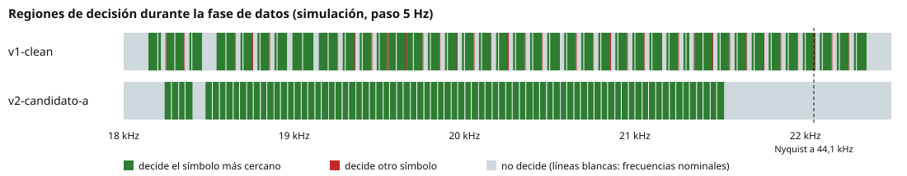

# E005 — V1 Clean frente al mapa candidato V2-A

**Estado:** ejecutado el 2026-11-17 · **Alcance:** simulación digital
determinista. **El candidato no está adoptado ni conectado a la interfaz.**

## Pregunta

Un mapa diseñado a partir de E003 y E004, ¿mejora las mismas mediciones sin
empeorar otras?

## Candidato V2-A

Definido en `src/web/static/js/simulacion/mapa_candidato_v2.js`:

- 41 tonos de 18 200 a 21 480 Hz con paso uniforme de 80 Hz, en orden;
- START, SYNC y END en las tres primeras posiciones, y una posición vacía antes
  de los datos;
- mismo alfabeto de 38 caracteres que V1;
- decisión por frecuencia más cercana (máximo 40 Hz) y acuerdo de tres cuadros.

Reproducir: `npm run experiment:e005`. Datos en
[results/latest.json](results/latest.json).

## Resultados — MEDIDO

| Medida | V1 Clean | V2-A |
|---|---|---|
| Banda ocupada | 18 200–22 300 Hz | 18 200–21 480 Hz |
| Tonos por encima de Nyquist a 44,1 kHz | 3 | 0 |
| Separación mínima entre tonos | 100 Hz | 80 Hz |
| Margen mínimo de decisión | 19 Hz | 39 Hz |
| Banda con símbolo equivocado (lógico) | 4,2 % | 0 % |
| Caracteres correctos a 44,1 kHz, sin ruido | 35/38 | 38/38 |

Caracteres correctos de 38 según el desvío de frecuencia (48 kHz, sin ruido):

| Desvío (Hz) | −40 | −30 | −20 | −10 | 0 | +10 | +20 | +30 | +40 | +50 |
|---|---|---|---|---|---|---|---|---|---|---|
| V1 Clean | 6 | 8 | 21 | 33 | 38 | 38 | 37 | 36 | 35 | 32 |
| V2-A | 19 | 36 | 38 | 38 | 38 | 38 | 38 | 35 | 18 | 2 |

SER frente a atenuación (48 kHz, símbolo de 60 ms):

| SNR | −12,2 dB | −16,7 dB | −18,2 dB | −20,2 dB | −22,7 dB |
|---|---|---|---|---|---|
| V1 Clean | 0,00 | 0,20 | 0,49 | 0,83 | 0,95 |
| V2-A | 0,00 | 0,16 | 0,46 | 0,79 | 0,95 |

## Lectura honesta

**Lo que mejora.** V2-A decodifica todo el alfabeto a 44,1 kHz, no confunde
vecinos dentro de su región y es simétrico: aguanta ±20 Hz sin un solo error,
donde V1 ya pierde 17 de 38 caracteres a −20 Hz.

**Lo que no mejora.** Frente al ruido los dos sistemas son prácticamente
iguales. Cambiar el mapa no da alcance; eso depende de la detección y de la
duración efectiva de análisis (E004).

**Lo que empeora.** Con desvíos positivos grandes V1 aguanta más (+40 Hz:
35 frente a 18), porque su región se extiende 59 Hz hacia arriba. Y hay una
diferencia de calidad en el fallo: fuera de su región V1 casi siempre **pierde**
el símbolo (a −20 Hz: 0 equivocados, 17 perdidos), mientras que V2-A **decide
el vecino** (a +40 Hz: 19 equivocados, 1 perdido), porque sus regiones se tocan
sin zona muerta. Sin detección de errores, un carácter equivocado es peor que
uno perdido.

## Decisiones que quedan abiertas

1. No adoptar V2-A tal cual. Antes hay que decidir si se deja una zona muerta
   (por ejemplo, máximo 30 Hz con paso de 80) o si se añade una suma de
   verificación al mensaje; ambas son medibles con este mismo experimento.
2. El paso de 80 Hz fue elegido para caber bajo 21,7 kHz; no está optimizado.
3. Todo esto es digital. La respuesta real de altavoces y micrófonos cerca de
   20 kHz puede cambiar qué banda conviene. **PENDIENTE** de medición física.
